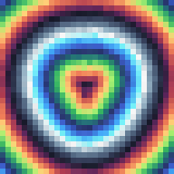
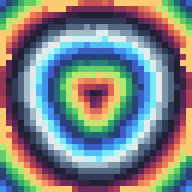

# Perfect Pixel 192

[中文](README.md) · **English**

Perfect Pixel 192 is a local browser editor for refining pixel art. Detect a pixel grid, sample one color per cell, edit the result on layers, and export a PNG with sharp edges and transparency.

## Open the editor

- **Standalone:** Download the repository, extract it, and open `demo.html` in Chrome or Edge. The file includes the editor and needs no installation.
- **Browser extension:** Open the extensions page in Chrome or Edge, enable Developer mode, choose **Load unpacked**, and select the folder that contains `manifest.json`. You can then send a web image to the editor from its context menu.

Use the language button at the top to switch between English and Chinese. On first use, Chinese browser locales select Chinese and other locales select English. The editor remembers your choice when browser storage is available. Save your PNG before refreshing the page; canvases are kept for the current session.

## Make a 192 × 224 portrait with 4 × 4 pixel blocks

1. Open an image. Under **Grid**, choose **Manual** and enter **48 columns** and **56 rows**. If editing one value changes the other, click the chain to unlock the aspect ratio first.
2. Enable **Lock to an evenly spaced grid**. Choose **Center pixel** for the first pass and **None** for the second.
3. Try a 32-color palette. Under **Output and export**, set **Export size** to **192 × 224 (portrait)** and choose **Export PNG**.

The sampling grid controls how many colors are sampled across the image. Export size controls the dimensions of the PNG. In this example, each of the 48 × 56 sampled cells becomes a solid 4 × 4 block. A second sampling pass operates on the first result at the same pixel dimensions.

## Edit the result

| Action | Control |
|---|---|
| Paint, erase or pick a color | Left-drag to paint, right-drag to erase, Alt-click to sample a color. The transparency slider also applies to the bucket. |
| Fill a region | Select the bucket and click a pixel. The fill follows matching colors in four directions and stays inside the selection. |
| Select part of the image | Drag with the lasso. Click to clear the selection. Drag near a view edge to pan. |
| Pan and zoom | Middle-drag to pan, scroll to zoom at the pointer, or click **Fit** to reset. |
| Remove a background | Use automatic edge-connected removal for a simple background, or draw a lasso to preserve a subject manually. |
| Manage layers | Open **Layers** below the canvas. Add, hide, reorder or delete layers. PNG export composites visible layers. |
| Edit a sampled color | Click a swatch to edit its color, lightness and opacity. The wheel shows analogous, triadic or tetradic suggestions. |
| Undo | Ctrl+Z undoes canvas strokes, fills and selections. **Undo settings** handles settings and layer operations. |

### Sampling and precision

**Auto detect** estimates the grid from repeated pixel structure. Use manual dimensions if the image has an ambiguous pattern. **Center pixel** preserves sharp lines; **Center crop average** reduces soft-edge noise. **Strong** limits colors and removes speckles. **Outline priority** works best for single subjects on simple backgrounds. For manual grids above 512 cells per side, enable **High precision** to raise the limit to 2048.

### Preview

The images below come from the editor's built-in procedural demo. Both use a 32 × 32 sampling grid and are enlarged to 192 × 192.

| Center pixel | Strong, up to 32 colors |
|---|---|
|  |  |

## Development

The JavaScript editor uses no third-party runtime dependencies. With Node.js installed, run:

```sh
node test/test-core.mjs
node test/test-strong.mjs
node test/test-static.mjs
node tools/build-standalone.mjs
```

The extension uses `app.html` and the JavaScript modules directly. Rebuild `demo.html` after changing the editor, styles or translations. The interface translations live in `i18n.js`.

## License and attribution

Perfect Pixel 192 is distributed under the [MIT License](LICENSE). Parts of the grid estimation and near-square correction routines were adapted from theAmusing's Perfect Pixel. See [third-party notices](THIRD_PARTY_NOTICES.md) for attribution and upstream license information.
