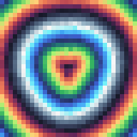
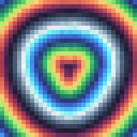
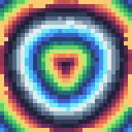
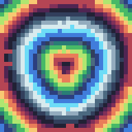

# Perfect Pixel 192

**中文** · [English](README.en.md)

把 AI 生成 / 被缩放过的「像素图」重新还原成**真正的完美像素**：自动识别格宽 → 每格取回唯一颜色 → 最近邻放大导出，永不插值。

本项目在浏览器中实现像素画网格检测、采样与编辑。算法来源见文末的第三方说明。

## 效果预览

六张预览均由编辑器内置的 makeDemo() 程序图案生成，无外部角色图片。输入使用 32×32 等距网格，结果以最近邻放大到 192×192。

| 单像素中心 | 中心裁剪均值 |
|---|---|
|  |  |
| 强劲模式（32 色上限） | 强劲模式（16 色上限） |
|  |  |
| 强劲模式（8 色上限） | 区域吸附 |
|  |  |

强劲模式会把轮廓外侧的抗锯齿混色环并进背景、把背景刷平、去掉孤立杂点；`region` 模式则把颜色压到 6~12 个主色。

---

## 30 秒上手（两条路，任选其一）

**A. 只想先看看效果 —— 双击 `demo.html`**
`demo.html` 是单文件版（CSS/JS 全内联），双击就能在 Chrome/Edge 里打开，点右上角「载入示例」立刻看到对比效果。缺点：没有「网页右键导入」和 URL 导入。

> 注意：别双击 `app.html`。它用的是 ES module（`<script type="module">`），`file://` 协议下会被 Chrome 的 CORS 策略拦掉，必须走扩展环境或 http 服务。

**B. 当插件日常用 —— 装扩展**
1. 打开 `chrome://extensions`（Edge：`edge://extensions`），右上角开启**开发者模式**。
2. 点「加载已解压的扩展程序」，选择本目录 `perfect-pixel-192`。
3. 点工具栏的 ▦ 图标 → 打开编辑器页。想固定到工具栏就点拼图图标里的图钉。

## 用起来是什么样

打开后界面分左右两栏：左边是画布（原图与结果叠在一起，用底部「对比」滑块擦除过渡），右边是控制面板。

**第一步 · 进图**（四选一）

| 方式 | 操作 |
|---|---|
| 拖拽 | 把 png/jpg/webp 文件拖进左侧画布 |
| 粘贴 | 截图后 `Ctrl+V`，最快 |
| 选文件 | 右上角「选择图片」 |
| 右键菜单 | 在任意网页图片上右键 →「用 Perfect Pixel 192 处理这张图」 |

**第二步 · 看诊断**（右侧最下面的卡片）

看到 `检测格数 32 × 32`、`单格尺寸 6.00 × 6.00 px`、`置信度 90%+` 就对了。格数明显不对（比如 6px 的格子被判成 3px），说明是罕见的非整数格宽，切到「网格 → 手动指定」，填真实的格数即可，这一步是精确的。

**第三步 · 选采样**（右侧第一张卡片）

- `中心裁剪均值`（默认）：只平均格子中央 50%，避开软边。
- **`★ 强劲模式 · 去抗锯齿成品`**：中心加权众数取色 → 只用“占面积的纯色区域”建调色板 → 每一格吸附到调色板。描边上的抗锯齿混色会被抹成相邻主色，得到**单一干净的线条**。代价是会主动丢掉只占几格的杂色，细节损失比其他模式大——出成品图时用它。
- `单像素中心`：最锐利，最容易被噪点带偏。
- `直方图众数 / 中位数`：抗噪，中位数是上游原版行为。

**第四步 · 限色**（「颜色数」卡片）

AI 出的像素图经常残留几百上千个邻近色，肉眼几乎一样但会让文件变大、无法索引。点 `16 / 32 / 64`（或 `8`）把输出压到指定色数，下面的色块条就是最终调色板，单击色块可编辑，右键可复制 HEX。
面板会显示 `采样后 2356 色 → 限制到 16 色，实际 16 色`，`不限` 则保留全部。

**第五步 · 导出**

「目标尺寸」选 `192 × 192`（默认）→ 点「导出 PNG」。下方的灰字会告诉你是不是整数倍最近邻放大（是的话每个像素块纯色、无插值）。


## 192px 支持情况

上游 `perfect_pixel.py` 写死了 `min_size=4.0` 与 `max_pixel_size=20.0`，192px 宽的图只有 **10~48 格**（约 4~19px 格宽）能通过它的合理性校验；64×64、96×96 这类 2~3px 细格会被判为"不一致"并降级。本实现把窗口放宽到 **2~64px**，并新增块一致性判据：

| 输入 | 逻辑格 | 格宽 | 本扩展 | 上游 |
|---|---|---|---|---|
| 192×192 | 24×24 | 8px | ✅ | ✅ |
| 192×192 | 32×32 | 6px | ✅ | ✅ |
| 192×192 | 48×48 | 4px | ✅ | ⚠️ 边缘 |
| 192×192 | 64×64 | 3px | ✅ | ❌ |
| 192×192 | 96×96 | 2px | ✅ | ❌ |
| 192×192 | 40×40 | 4.8px | ⚠️ 可能偏 1 格 | ❌ |
| 192×192 | 56×56 | 3.43px | ⚠️ 常见 28 格的倍频误判 | ❌ |

「✅」= 有自动化测试覆盖；「⚠️」= 非整数格宽，检测可能偏 ±1 格，请用**手动指定格数**兜底（面板「网格 → 手动指定」），这一步是精确的。

## 算法

与上游同构的四步管线，每一步都做了修正：

1. **格宽估计**（四级回退，取第一个可用者）
   - ① 块边界一致性（本实现新增）：真实格宽 c 必须让所有色变都落在 c 的倍数边界上，即"块内相邻像素差能量 / 总差能量" `r(c)→0`；且 `r(c)≈0` 的最大 c 就是真实格宽。对 2px 细格依然成立，而 Sobel 投影在这种情况下已无周期性。
   - ② 频域自相关：梯度投影去趋势后做 FFT 自相关（Wiener–Khinchin），取最小可信周期并做抛物线亚像素插值。上游此处用 `1-log(1+|F|)` 且阈值 0.35，实际是在找"能量低点"，数值上不可靠。
   - ③ 梯度峰间隔中位数：逐字移植上游 `estimate_grid_gradient`。
   - ④ 梳状搜索：直接最小化 `|g[i]−g[i+p]|` 的均值。
2. **网格线精修**：以 0 为起点构建整数点阵，测"边界对比度"，对比度足够时把每条线在 ±0.35 格内吸附到最强梯度峰（保持单调）；对比度不足（细格）时直接用精确点阵。上游是从中心逐条累加吸附，会漂移并产生图外多余线。
3. **逐格采样**：`core`（中心 50% 裁剪均值，默认）/ `strong`（★ 强劲模式）/ `center` / `majority`（32 级分桶直方图众数）/ `median`。上游只有后两种，且在软边图上误差较大——实测 3×3 模糊 + 噪声下，`core` 最大通道误差 3/255，上游的 `median` 是 72/255。
4. **强劲模式（去抗锯齿）**：中心加权直方图众数取色 → 把颜色按 CIELab 接近度聚成"颜色区域" → 只保留面积 ≥0.5% 的区域，再剔除"夹在两个更大色块正中间"的色（这正是 50% 抗锯齿混色的 Lab 位置特征）→ 每一格吸附到该调色板。描边因此变成单一颜色，混色环消失。
5. **限色**（可选）：把输出压到 8/16/32/64 色。唯一色 ≤ 320 时用**层次合并**（反复并掉"合并后 SSE 增量最小"的一对簇），更多时用**中位切分做初值 + Lloyd 迭代精修**。**合并与吸附距离全部在 CIELab 空间计算**，避免 RGB 欧氏距离把"深藏青 vs 纯黑""暗红 vs 亮红"判得过近而导致配色发灰。两条路都完全确定性。
6. **正方形对齐**：移植上游 `fix_square`。

## 与上游差异一览

| 项 | 上游 perfectPixel | 本项目 |
|---|---|---|
| 形态 | Python 库 + ComfyUI 节点 | Chrome/Edge MV3 扩展（含独立编辑器页） |
| 格宽窗口 | `[4, 20]` px 硬编码 | `[2, 64]` px 且可调 |
| 192px 细格 | 不支持 | 支持到 2px 格（96×96） |
| 频域判据 | `1-log(1+|F|)` 取反 + 0.35 阈值 | 梯度投影自相关 + 亚像素插值 |
| 网格线 | 中心出发逐条吸附（会漂移） | 精确点阵 + 受限吸附 + 单调约束 |
| 采样 | center / median / kmeans-majority | + `core`（抗软边），majority 改确定性直方图众数 |
| 限色 | 无 | 8 / 16 / 32 / 64 色，层次合并 + 中位切分双路径，带调色板预览 |
| 透明度 | 基本忽略 | 逐通道处理 alpha |
| 导出 | 返回数组 | 1× / 原尺寸 / 192 / 384 / 512 / 1024，整数倍最近邻 |

## 测试

```bash
node test/test-core.mjs     # 43 项算法断言（合成图：整数格、2px 细格、非方形、矩形格、模糊+噪声、手动指定、放大纯度、退化输入）
node test/test-strong.mjs   # 14 项成品模式断言（清外侧/背景刷平/去孤点/AA 中点数/确定性）
node test/test-static.mjs   # DOM id 双向一致、core 导出完整、manifest 合法性、MV3 CSP 合规
node test/bench-grid.mjs    # 网格检测命中率基准（常规 4~16px 格 87%，2~4px 极细格 36%）
```

算法层是 DOM 无关的纯函数（`core.js`），所以能在 Node 里直接跑断言；UI 层通过静态一致性检查（每个 `#id` 双向对应、无内联脚本）验证。

## 已知限制

- **非整数格宽**（如 192px 排 40 格 = 4.8px/格）依赖自相关插值，可能偏 1 格 → 用手动格数。
- **2~3.4px 极细格**（56×56 以上）在 Sobel 下几乎不可分辨，容易误判成倍频（28×28）→ 用手动格数或直接当作原图。
- 照片/渐变图没有像素格，检测会给出低置信度提示，此时输出等于降采样，不是本工具的用途。
- 超大图（>8MP）扫描会降采样以控制耗时，格宽估计的亚像素精度略降。

## 隐私

所有处理都在本地 canvas 完成，不上传任何图片、不注入任何页面脚本。`host_permissions: <all_urls>` 仅用于「URL 导入」和右键菜单取图；不需要时可在 `manifest.json` 删掉该行，其余功能不受影响。

## 项目结构

```
perfect-pixel-192/
├─ manifest.json          扩展清单（MV3）
├─ background.js          后台：右键菜单 + 点图标开编辑器
├─ app.html / app.css / app.js   编辑器界面
├─ core.js                全部算法（网格检测 / 采样 / 限色 / 清外侧），DOM 无关，可在 Node 里直接测
├─ demo.html              单文件版（CSS/JS 内联，双击即用，由 tools/build-standalone.mjs 生成）
├─ icons/                 16/32/48/128 图标（由 tools/make_icons.py 生成）
├─ test/                  43 项算法断言 / 14 项成品模式断言 / 静态检查 / 检测基准
├─ tools/                 构建与图标脚本
└─ docs/                  效果预览图
```

## 开发

不需要任何依赖，克隆下来直接跑：

```bash
node test/test-core.mjs      # 算法回归
node test/test-strong.mjs    # 成品模式回归
node test/test-static.mjs    # 静态一致性
node tools/build-standalone.mjs   # 改完 app.js / core.js 后重新生成 demo.html
```

Windows 上一键自检 + 备份：

```powershell
powershell -ExecutionPolicy Bypass -File tools\verify.ps1    # 跑全部断言，失败返回非零
powershell -ExecutionPolicy Bypass -File tools\backup.ps1    # 打成带时间戳的 tar.gz（含 .git 历史）
```

CI 已配好（`.github/workflows/test.yml`），push 到 GitHub 后会自动跑上面三个测试。

> 改动前建议先 `git commit` 或跑一次 `tools\backup.ps1`：`.git` 提供逐次提交的历史，`_backups/` 提供整包快照，两者互补。


## 许可证

本项目的许可文本见 [LICENSE](LICENSE)。网格估计、梯度峰间隔与近方形修正等算法参考或改编自 theAmusing 的 Perfect Pixel。已核实的上游发行版为 perfect-pixel 0.1.4，其 PyPI 元数据声明 MIT。第三方署名及许可见 [THIRD_PARTY_NOTICES.md](THIRD_PARTY_NOTICES.md)。
